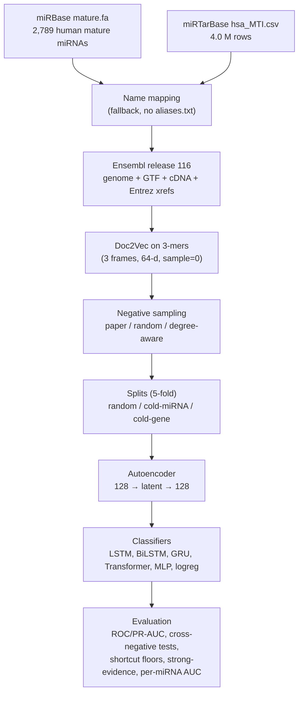
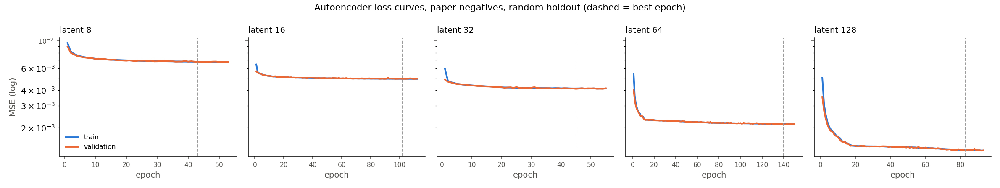
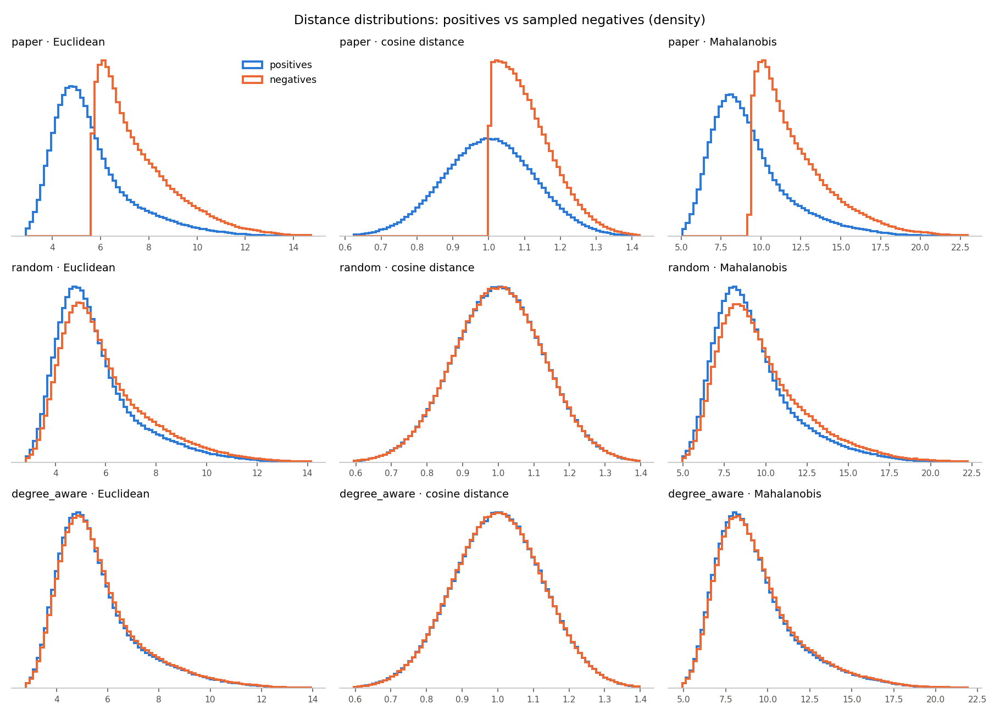
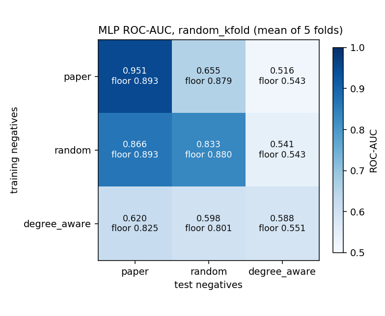
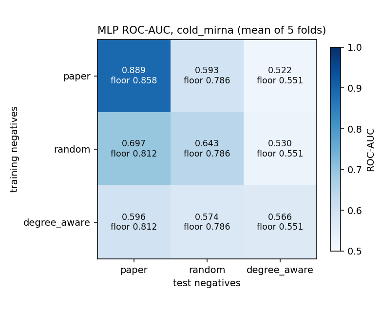
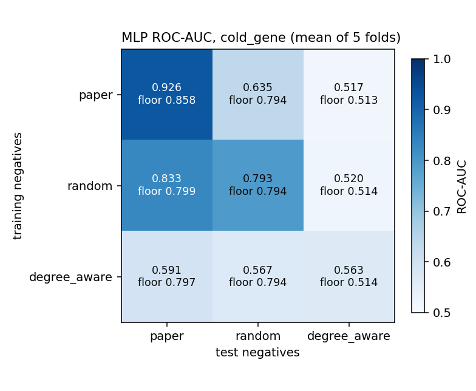
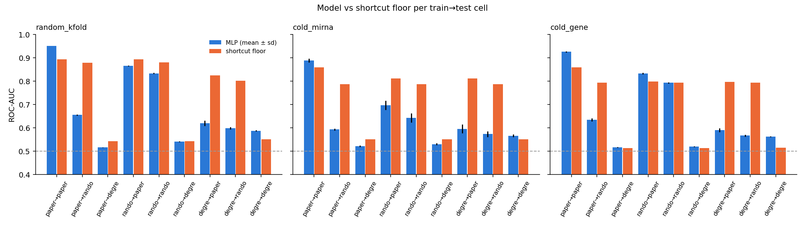
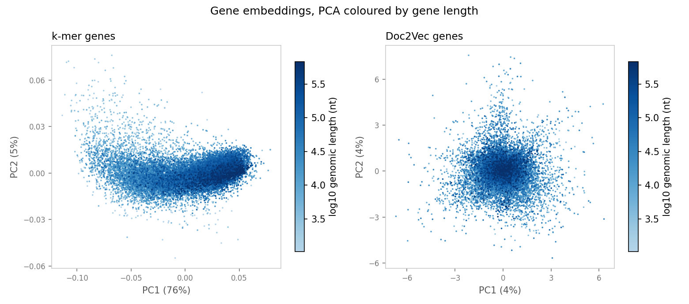

# AEmiGAP Replication: a critical reimplementation of autoencoder-based miRNA–gene association prediction

  

## TL;DR

- I reimplemented AEmiGAP end to end (miRBase + miRTarBase + Ensembl → Doc2Vec 3-mer embeddings → autoencoder → LSTM) and reproduced its headline result within about 3 AUC points: **0.952 ± 0.001** 5-fold ROC-AUC vs **0.985** in the paper.
- Most of that performance comes from **how negatives are sampled**. The paper's distance-based negatives can be separated by distance alone (AUC 0.859) or by node degree (0.894) without any model.
- On **shortcut-controlled (degree-aware) negatives**, the same models reach only **0.56–0.59** ROC-AUC, and a model trained on the paper's negatives scores **0.516** on them.
- The autoencoder adds about **+0.002** AUC, and a plain MLP matches the LSTM.

> **This is an independent, unofficial reimplementation.** It is not affiliated with or endorsed by the original authors. All numbers below come from the result files in this repository.

## Contents

- [Background](#background)
- [Pipeline overview](#pipeline-overview)
- [Data](#data)
- [Implementation notes](#implementation-notes)
- [Results 1 — Replication](#results-1--replication)
- [Results 2 — Shortcut diagnostics](#results-2--shortcut-diagnostics)
- [Results 3 — Robustness across negatives and splits](#results-3--robustness-across-negatives-and-splits)
- [Results 4 — Strong-evidence and per-miRNA AUC](#results-4--strong-evidence-and-per-mirna-auc)
- [Embedding diagnostics](#embedding-diagnostics)
- [Key findings](#key-findings)
- [Limitations](#limitations)
- [Future work](#future-work-not-done)
- [Reproduce](#reproduce)
- [Repository structure](#repository-structure)
- [Citation, acknowledgements and license](#citation-acknowledgements-and-license)

## Background

**AEmiGAP** (Yoon S, Yoon H, Cho J, Lee K. *AEmiGAP: AutoEncoder-Based miRNA–Gene Association Prediction Using Deep Learning Method.* Int. J. Mol. Sci. 2024, 25, 13075. [doi:10.3390/ijms252313075](https://doi.org/10.3390/ijms252313075)) predicts whether a human microRNA targets a gene. It works as follows:

1. It embeds miRNA sequences and full gene sequences with a Protein2Vec-style Doc2Vec model over 3-mers.
2. It builds negative pairs by picking miRNA–gene pairs whose embeddings are *far apart*. A pair qualifies if its Euclidean, cosine and Mahalanobis distances are all above the means of the positive pairs.
3. It trains an autoencoder on the concatenated pair embedding and appends the latent code to the original features.
4. It classifies pairs with an LSTM, reporting ROC-AUC 0.9846 (5-fold) and comparing against its predecessor miGAP (the same model without the autoencoder, 0.9804).

This repository rebuilds that pipeline from public data. It then asks how much of the reported performance survives when the negatives no longer contain an easy shortcut, and when test miRNAs or genes are unseen during training.

## Pipeline overview



## Data

| source | file | version / date | link |
|---|---|---|---|
| miRBase | `mature.fa` | current release, downloaded Sept 2026 (the file carries no version tag) | <https://mirbase.org/download/mature.fa> |
| miRTarBase | `hsa_MTI.csv` (human MTIs) | downloaded Sept 2026 (the file carries no version tag) | <https://mirtarbase.cuhk.edu.cn/> |
| Ensembl | GRCh38 primary assembly, GTF, cDNA, Entrez cross-references | **release 116** | <https://ftp.ensembl.org/pub/release-116/> |

**What survives each step** (from `results/step1_report.txt`, `step1b_report.txt`, `step2_report.txt`):

| step | count |
|---|---:|
| miRTarBase raw rows | 4,004,967 |
| human rows (miRNA and target both human) | 4,004,479 |
| unique (miRNA, gene) pairs | 1,730,805 |
| pairs whose miRNA name maps to mature.fa (exact / case-insensitive / single-arm) | 1,166,221 |
| unique pairs after merging duplicate names | 1,162,644 |
| positives (strong or weak functional evidence) | 1,162,320 |
| positives whose gene maps to Ensembl (symbol 16,590 genes, Entrez 221, unmapped 71) | 1,160,343 |
| after dropping 8 genes with >10% N | 1,159,968 |
| **final positives** (after merging 7 genes reached by two symbols) | **1,159,808** |
| final miRNAs / genes | 2,334 / 16,796 |
| positives with strong evidence ("Functional MTI") / weak only | 8,135 / 1,151,673 |
| known pairs excluded from negative sampling | 1,804,060 |

**Deviations from the paper**

- **No miRBase `aliases.txt`.** The official endpoint returned HTTP 500 (and the legacy mirrors 404/500) throughout the project. Names are mapped with a mature.fa-only fallback: exact match, then case-insensitive match, then *single arm* (an arm-less name maps to X-5p or X-3p when only one exists). Names where **both arms exist are left unmapped ("ambiguous arm")**, which loses 462,250 of 1,730,805 pairs (27%).
- **Full genomic gene sequences** (the whole gene span, introns included; median 32,564 nt, maximum 2,473,539 nt), as the paper describes, rather than transcripts.
- **Doc2Vec with `sample=0`.** With only 64 distinct 3-mers, gensim's default downsampling (`sample=1e-3`) treats every token as frequent and discards about 69% of them.
- **miRNA vectors are inferred** (`infer_vector`, 200 epochs, seeded by sequence) rather than read from the trained document vectors. Each miRNA frame has only about 7 tokens, so trained vectors barely move from their initialisation (see [Embedding diagnostics](#embedding-diagnostics)).

## Implementation notes

- **Known pairs for negative sampling.** Anything that might be a real interaction is excluded from negatives. That covers every mapped pair (including non-functional-only ones), both arms of every ambiguous-arm name, and every lettered variant of not-found names (e.g. `hsa-miR-203` → `203a/203b`, both arms). This gives 1,804,060 pairs, 4.6% of the 2,334 × 16,796 grid.
- **Three negative strategies, one positive set.**
  - *paper*: all three distances above the positive means.
  - *random*: uniform over non-known pairs.
  - *degree_aware*: per miRNA, as many negatives as positives, with genes drawn proportionally to their positive degree.

  The positive pairs are identical across strategies.
- **Cold splits by sequence group.** cold_mirna groups miRNAs by identical mature sequence (`seq_group`), so identical sequences never straddle train and test. cold_gene groups by gene. Groups are assigned greedily to balance positives; validation sets are whole groups too. Positives get the same fold and validation membership under every strategy.
- **No leakage from preprocessing.** MinMax (autoencoder) and RobustScaler (classifier) are fit on each fold's training rows only. The autoencoder is retrained for each strategy × split × fold, and the classifier always uses the autoencoder from its own fold.
- **Early stopping instead of the paper's "5,000,000 iterations".** Classifiers stop on validation ROC-AUC (patience 5, max 50 epochs; MLP max 100). The autoencoder stops on validation MSE (patience 10).
- **CPU beat Apple MPS for these small models**: 6.3 s vs 15.5 s per autoencoder epoch, and 61.5 s vs 110.2 s per LSTM epoch.
- **Cross-negative evaluation.** `load_cross` trains on one strategy's negatives and tests on the held-out positives plus another strategy's negatives in the same fold. Test negatives that appear among the training strategy's train/validation rows are dropped.

## Results 1 — Replication

All numbers are test ROC-AUC on paper-style negatives, latent size 64 unless stated.

**Paper Table 2 (LSTM, random holdout, by latent size)**

| latent | latent only (ours) | latent only (paper) | original + latent (ours) | original + latent (paper) |
|---:|---:|---:|---:|---:|
| 8 | 0.7990 | 0.9022 | 0.9499 | 0.9818 |
| 16 | 0.8003 | 0.8988 | 0.9512 | 0.9837 |
| 32 | 0.8612 | 0.9229 | 0.9515 | 0.9832 |
| 64 | 0.9351 | 0.9231 | 0.9510 | 0.9846 |
| 128 | 0.9355 | 0.9331 | 0.9521 | 0.9840 |

*What to look for:* with the original embeddings included, performance is flat across latent sizes (ours and the paper's), and ours sits about 3 points lower. With the latent code alone, small codes (8–32) do much worse than the paper reports, while 64 and 128 match it.

**Paper Tables 3 and 11 (LSTM, 5-fold CV)** — mean ± std over folds. The paper numbers its folds 1–5 and we use 0–4, so compare means, not individual folds. The paper reports no PR-AUC.

| metric | AEmiGAP, ours | AEmiGAP, paper (Table 3) | miGAP, ours | miGAP, paper (Table 11) |
|---|---:|---:|---:|---:|
| ROC-AUC | 0.9520 ± 0.0006 | 0.9846 ± 0.0018 | 0.9499 ± 0.0002 | 0.9804 |
| Accuracy | 0.8776 ± 0.0007 | 0.9456 ± 0.0033 | 0.8749 ± 0.0001 | 0.9340 |
| F1 | 0.8742 ± 0.0011 | 0.9466 ± 0.0034 | 0.8716 ± 0.0009 | 0.9326 |
| Precision | 0.8990 ± 0.0049 | 0.9658 ± 0.0147 | 0.8953 ± 0.0056 | 0.9380 |
| Recall | 0.8508 ± 0.0061 | 0.9284 ± 0.0080 | 0.8491 ± 0.0069 | 0.9278 |
| PR-AUC | 0.9588 ± 0.0005 | not reported | 0.9570 ± 0.0002 | not reported |

*What to look for:* the autoencoder ("AEmiGAP") beats the plain embeddings ("miGAP") in both studies, but our gain is only +0.0021 AUC. Our fold-to-fold spread is very small.

**Paper Table 13 (models, random holdout)**

| model | ROC-AUC (ours) | ROC-AUC (paper) | note |
|---|---:|---:|---|
| lstm | 0.9510 | 0.9846 |  |
| bilstm | 0.9551 | 0.9638 |  |
| gru | 0.9479 | 0.9478 |  |
| transformer | 0.9582 | 0.9436 |  |
| lstm_timesteps | 0.5342 | – | capped: batch 1024, max 3 epochs |
| mlp | 0.9507 | – | not in the paper; step 7 run (max 50 epochs) |

*What to look for:* the paper's clear LSTM advantage does not reproduce; our four sequence models are within 0.01 of each other. `lstm_timesteps` is the literal reading of the paper (the concatenated vector fed as a sequence of scalars). At about 33 minutes per epoch it was **capped at batch 1024 and 3 epochs**, and it stayed at chance level (training loss 0.693), so its number is not a fair estimate of that architecture.



The autoencoders beat a predict-the-mean baseline by 2.3× (latent 8) to 12× (latent 128). Over 5 folds at latent 64, test MSE is 0.002271 ± 0.000211, against a baseline of about 0.0153 (`results/step6_report.txt`).

## Results 2 — Shortcut diagnostics

Before training any model, each negative set was checked for features that separate it from the positives (`results/step4_report.txt`). KS is the Kolmogorov–Smirnov statistic between positive and negative distributions (0 = identical). The AUCs come from a logistic regression on a single cheap feature.

| diagnostic | paper | random | degree_aware |
|---|---:|---:|---:|
| KS Euclidean distance | 0.613 | 0.084 | 0.020 |
| KS cosine distance | 0.499 | 0.001 | 0.002 |
| KS Mahalanobis distance | 0.599 | 0.079 | 0.017 |
| KS log10 gene length | 0.324 | 0.130 | 0.021 |
| KS gene vector norm | 0.468 | 0.080 | 0.016 |
| Spearman(#pos, #neg) per gene / per miRNA | −0.154 / −0.157 | −0.346 / −0.400 | +0.992 / +1.000 |
| AUC: 3 distances only | **0.859** | 0.561 | 0.516 |
| AUC: log gene length only | 0.711 | 0.582 | 0.513 |
| AUC: node degree (train split only) | **0.894** | **0.880** | 0.551 |
| AUC: raw embeddings, linear | 0.685 | 0.613 | 0.507 |

*What to look for:* paper-style negatives are separable by distance and by degree without any model. Random negatives are separable by degree, because hub miRNAs and genes have many positives but negatives are spread evenly. Degree-aware negatives remove every shortcut (all ≤ 0.551).

The paper's rule selects 9,347,295 of 37,397,804 candidate pairs (25%; the paper reports 4,932,554 of about 38 M).



## Results 3 — Robustness across negatives and splits

Rows are the negatives used for training; columns are the negatives used for testing (the positives are always the same held-out positives).

- **MLP:** mean ± std over 5 folds.
- **LSTM f0:** fold 0 only.
- **floor:** the best shortcut baseline in that cell (distances, gene length or train-split degree), averaged over folds.

**random_kfold**

| train ↓ / test → | paper | random | degree_aware |
|---|---|---|---|
| **paper** | MLP **0.951** ± 0.001<br>LSTM f0 0.951<br>floor 0.893 (degree) | MLP **0.655** ± 0.002<br>LSTM f0 0.668<br>floor 0.879 (degree) | MLP **0.516** ± 0.001<br>LSTM f0 0.519<br>floor 0.543 (degree) |
| **random** | MLP **0.866** ± 0.002<br>LSTM f0 0.886<br>floor 0.893 (degree) | MLP **0.833** ± 0.003<br>LSTM f0 0.871<br>floor 0.880 (degree) | MLP **0.541** ± 0.002<br>LSTM f0 0.569<br>floor 0.543 (degree) |
| **degree_aware** | MLP **0.620** ± 0.012<br>LSTM f0 0.643<br>floor 0.825 (degree) | MLP **0.598** ± 0.005<br>LSTM f0 0.637<br>floor 0.801 (degree) | MLP **0.588** ± 0.003<br>LSTM f0 0.622<br>floor 0.551 (degree) |

**cold_mirna** (test miRNA sequence groups unseen in training)

| train ↓ / test → | paper | random | degree_aware |
|---|---|---|---|
| **paper** | MLP **0.889** ± 0.008<br>LSTM f0 0.895<br>floor 0.858 (distances) | MLP **0.593** ± 0.004<br>LSTM f0 0.603<br>floor 0.786 (degree) | MLP **0.522** ± 0.004<br>LSTM f0 0.521<br>floor 0.551 (degree) |
| **random** | MLP **0.697** ± 0.019<br>LSTM f0 0.727<br>floor 0.812 (degree) | MLP **0.643** ± 0.020<br>LSTM f0 0.700<br>floor 0.786 (degree) | MLP **0.530** ± 0.004<br>LSTM f0 0.537<br>floor 0.551 (degree) |
| **degree_aware** | MLP **0.596** ± 0.018<br>LSTM f0 0.609<br>floor 0.812 (degree) | MLP **0.574** ± 0.012<br>LSTM f0 0.603<br>floor 0.786 (degree) | MLP **0.566** ± 0.006<br>LSTM f0 0.582<br>floor 0.551 (degree) |

**cold_gene** (test genes unseen in training)

| train ↓ / test → | paper | random | degree_aware |
|---|---|---|---|
| **paper** | MLP **0.926** ± 0.003<br>LSTM f0 0.922<br>floor 0.858 (distances) | MLP **0.635** ± 0.007<br>LSTM f0 0.640<br>floor 0.794 (degree) | MLP **0.517** ± 0.002<br>LSTM f0 0.519<br>floor 0.513 (log_length) |
| **random** | MLP **0.833** ± 0.003<br>LSTM f0 0.798<br>floor 0.799 (distances) | MLP **0.793** ± 0.003<br>LSTM f0 0.773<br>floor 0.794 (degree) | MLP **0.520** ± 0.002<br>LSTM f0 0.516<br>floor 0.514 (distances) |
| **degree_aware** | MLP **0.591** ± 0.009<br>LSTM f0 0.584<br>floor 0.797 (degree) | MLP **0.567** ± 0.004<br>LSTM f0 0.568<br>floor 0.794 (degree) | MLP **0.563** ± 0.001<br>LSTM f0 0.568<br>floor 0.514 (distances) |

*What to look for:*

- **The diagonal** (train and test on the same negatives):
  - On *paper* negatives the models beat their floor, but only by 0.03–0.07, so most of the AUC is already available to a single shortcut feature.
  - On *random* negatives they are at or below the degree floor.
  - On *degree-aware* negatives they reach 0.56–0.59, only 0.01–0.05 above a floor near 0.51–0.55.
- **The first row** shows a model trained on paper negatives collapses to about 0.52 on degree-aware negatives.
- **Caveat on the floors in off-diagonal cells:** a single-feature baseline's AUC depends only on the sign of its weight. So those floors mostly measure how separable the *test* negatives are by that feature, rather than what was learned in training.

| random_kfold | cold_mirna | cold_gene |
|---|---|---|
|  |  |  |



## Results 4 — Strong-evidence and per-miRNA AUC

- **Strong-evidence AUC** keeps only test positives with "Functional MTI" evidence (reporter assay, western blot, …) plus all test negatives.
- **Per-miRNA AUC** is the mean ROC-AUC computed within each test miRNA that has at least 10 positives and 10 negatives. It asks whether the model ranks targets *within* a miRNA, not just between miRNAs.

| split | negatives (train = test) | MLP ROC-AUC | MLP strong-evidence AUC | MLP per-miRNA AUC | LSTM f0 ROC-AUC | LSTM f0 strong-evidence AUC | LSTM f0 per-miRNA AUC |
|---|---|---:|---:|---:|---:|---:|---:|
| random_kfold | paper | 0.951 | 0.891 | 0.913 | 0.951 | 0.894 | 0.916 |
| random_kfold | random | 0.833 | 0.680 | 0.683 | 0.871 | 0.734 | 0.778 |
| random_kfold | degree_aware | 0.588 | 0.565 | 0.571 | 0.622 | 0.576 | 0.593 |
| cold_mirna | paper | 0.889 | 0.858 | 0.898 | 0.895 | 0.873 | 0.911 |
| cold_mirna | random | 0.643 | 0.607 | 0.664 | 0.700 | 0.696 | 0.755 |
| cold_mirna | degree_aware | 0.566 | 0.564 | 0.556 | 0.582 | 0.547 | 0.561 |
| cold_gene | paper | 0.926 | 0.857 | 0.869 | 0.922 | 0.865 | 0.866 |
| cold_gene | random | 0.793 | 0.629 | 0.566 | 0.773 | 0.623 | 0.568 |
| cold_gene | degree_aware | 0.563 | 0.546 | 0.549 | 0.568 | 0.564 | 0.554 |

*What to look for:* strongly validated targets are ranked **worse** than the weak, mostly CLIP-derived positives on paper and random negatives. For example, the MLP on paper negatives gets 0.951 overall but 0.891 on strong evidence. On degree-aware negatives, ranking within a miRNA is close to chance.

## Embedding diagnostics

From `results/step3_report.txt`. The baseline is overlapping 3-mer frequencies (k-mer); Doc2Vec is trained on full genomic gene sequences. "Centred" cosine is computed after subtracting the mean vector. "Family margin" is the mean of (within-family centred cosine − random-pair centred cosine) over let-7 and miR-200.

| metric | k-mer | Doc2Vec, trained miRNA vectors | Doc2Vec, inferred miRNA vectors |
|---|---:|---:|---:|
| let-7 family, centred cosine | 0.222 | 0.133 | 0.236 |
| miR-200 family, centred cosine | 0.140 | 0.077 | 0.167 |
| miRNA family margin | 0.177 | 0.105 | **0.199** |
| identical-sequence miRNAs: max distance / median random distance | 0.000 | 0.829 | **0.000** |
| genes: HOXA / HOXB centred cosine | 0.534 / 0.802 | 0.214 / 0.138 | (same genes) |
| genes: KRT / OR / ZNF centred cosine | 0.391 / 0.385 / 0.191 | 0.011 / 0.019 / 0.003 | (same genes) |
| leakage: ridge R² predicting log gene length | 0.522 | 0.130 | (same genes) |
| leakage: Spearman of PC1 with log gene length | +0.527 | +0.024 | (same genes) |

*What to look for:*

- Inferred miRNA vectors capture family structure best, and identical sequences get identical vectors. These are the vectors used downstream.
- Doc2Vec gene vectors carry little paralog similarity beyond the HOX clusters.
- Doc2Vec leaks much less gene length than k-mers (R² 0.13 vs 0.52). However, the gene vector's *norm* still correlates with length (Spearman −0.50).
- Training took 1.57 h for 20 epochs on 1.28 billion tokens.



## Key findings

1. **The headline result reproduces in shape but not in level.** 5-fold ROC-AUC is 0.9520 ± 0.0006 vs 0.9846, and accuracy is 0.878 vs 0.946.
2. **The autoencoder contributes very little:** +0.0021 AUC over the same LSTM without it (paper: +0.0042).
3. **Architecture barely matters.** An MLP matches the LSTM (0.9507 vs 0.9510 on the holdout), and the paper's LSTM > BiLSTM > GRU > Transformer ranking does not reproduce.
4. **Paper-style negatives contain a strong shortcut.** Distances alone give AUC 0.859 and degree alone 0.894. A model trained on them scores 0.516 on degree-aware negatives.
5. **On shortcut-controlled negatives the task is barely learned:** 0.563–0.588 ROC-AUC across random, cold-miRNA and cold-gene splits.
6. **Unseen miRNAs are the hardest case.** With random negatives, the MLP drops from 0.833 (random split) to 0.643 (cold-miRNA), below the degree floor of 0.786.
7. **Strongly validated targets are ranked worse than weak (high-throughput) ones**, so the models mostly learn what CLIP-derived positives look like.

## Limitations

- **Fallback miRNA name mapping.** Without miRBase `aliases.txt`, 27% of miRTarBase pairs (462,250) are lost to ambiguous arms, and renamed miRNAs are only used to exclude negatives.
- **Different data.** The dataset is larger and newer than the paper's: 1,159,808 positives from a 2026 miRTarBase download, 2,334 miRNAs and 16,796 genes. Absolute numbers are therefore not directly comparable.
- **Intron-heavy gene embeddings.** Doc2Vec on full genomic sequences averages over mostly intronic, chunked documents, and the gene vector norm still tracks gene length.
- **One machine, one seed (42).** Multi-worker Doc2Vec training is not bit-reproducible, and fold-to-fold spread is reported, but not seed-to-seed spread.
- **`lstm_timesteps` is capped** (batch 1024, 3 epochs), so it is not a fair test of that architecture.
- **Shortcut floors use a single feature each**, so a combination of shortcuts could set a higher floor.

## Future work (not done)

- **Case studies with a "validated since" test:** train on interactions known before a cutoff date, then check predictions against interactions validated later.
- **Seed-match baselines** (TargetScan-style 7/8-mer site counts on 3'UTRs), which are the biologically motivated floor this task should beat.
- **RNA-FM (or other RNA language model) embeddings on cDNA/3'UTR sequences** instead of genomic Doc2Vec.

## Reproduce

Tested with **Python 3.11.9 on macOS (Apple Silicon M4)** with the system Python and `pip install --user -r requirements.txt`. All commands run from the repository root. Allow about **15 GB of free disk**: the data folder alone grows to about 11 GB, including the 2.9 GB uncompressed genome and the 4.8 GB Doc2Vec corpus.

**1. Download the raw files yourself** (they are not redistributed here):

- `data/raw/mature.fa` from <https://mirbase.org/download/mature.fa>
- `data/raw/hsa_MTI.csv` from miRTarBase (<https://mirtarbase.cuhk.edu.cn/>), human MTI table
- Ensembl release 116 files (about 1.2 GB compressed; URLs are in `configs/default.yaml` under `ensembl.urls`): genome primary assembly `.fa.gz`, GTF, `cdna.all.fa.gz` and `entrez.tsv.gz` into `data/raw/`
- optional: miRBase `aliases.txt` into `data/raw/`. If present and valid, name mapping switches automatically from the fallback rules to alias mode.

**2. Run the pipeline in order.** Runtimes are on an M4 MacBook Air, CPU.

| # | command | what it does | approx. time |
|---|---|---|---|
| 1 | `python3 -m src.parse` | parse mature.fa and miRTarBase | minutes |
| 2 | `python3 -m src.mirna_names` | name mapping, `seq_group` | seconds |
| 3 | `python3 -m src.genes` | gene mapping, genomic + cDNA sequences, indexes, known pairs | minutes (plus genome decompression) |
| 4 | `python3 -m src.embed build-corpus` then `kmer` | 3-mer corpus (4.8 GB) and k-mer baseline | minutes |
| 5 | `python3 -m src.embed pilot` (optional), then `nohup python3 -m src.embed train &` | Doc2Vec, 20 epochs; runs `extract` and `check` at the end | 1.57 h |
| 6 | `python3 -m src.negatives --strategy all` | three negative sets + shortcut diagnostics | minutes |
| 7 | `python3 -m src.splits` | 5-fold random / cold-miRNA / cold-gene folds | seconds |
| 8 | `python3 -m src.autoencoder --benchmark`, then `--replication-set` | device choice; 9 autoencoder runs (Tables 2/3) | about 95 min |
| 9 | `python3 -m src.classifier --smoke` | classifier benchmark + step 7 smoke runs | about 1 h |
| 10 | `python3 -m src.experiments --plan`, then `nohup caffeinate -i python3 -m src.experiments --run > results/step8_run.log 2>&1 &`, then `--report` | 421-job resumable queue (Blocks A–C) and the summary | about 20 h of compute (wall time: A 12.0 h including a 7 h battery sleep, C 0.34 h, B 12.6 h, A4 1.8 h) |

`--run` is resumable: re-running it skips every job whose `metrics.json` exists. Keep the Mac on AC power, because `caffeinate` cannot prevent low-battery hibernation.

## Repository structure

```
.
├── configs/default.yaml      # all paths, seeds, hyperparameters, Ensembl URLs, paper reference values
├── src/
│   ├── utils.py              # device selection, seeding, config loading
│   ├── parse.py              # step 1: mature.fa + miRTarBase parsing and report
│   ├── mirna_names.py        # step 1b: miRNA name mapping (alias mode / fallback), seq_group
│   ├── genes.py              # step 2: Ensembl gene mapping, sequences, indexes, known pairs
│   ├── embed.py              # step 3: 3-mer corpus, Doc2Vec, k-mer baseline, embedding checks
│   ├── negatives.py          # step 4: paper / random / degree-aware negatives + shortcut diagnostics
│   ├── splits.py             # step 5: folds, load_split / load_cross
│   ├── autoencoder.py        # step 6: autoencoder, encode()
│   ├── classifier.py         # step 7: LSTM/BiLSTM/GRU/Transformer/MLP/logreg, predict_cross()
│   └── experiments.py        # step 8: resumable job queue, baselines, aggregation, plots
├── results/
│   ├── step*_report.txt      # per-step reports (all numbers in this README come from these)
│   ├── step*.png             # diagnostics and loss curves
│   ├── step*.log             # training / queue logs (< 1 MB each)
│   ├── clf/<run>/            # per-run metrics.json, extra_metrics.json, config.json, epochs.csv
│   └── experiments/          # summary.md, tables (CSV), matrices, plots, baseline metrics, jobs.csv
├── requirements.txt          # pinned versions
└── LICENSE                   # MIT (code only)
```

Not committed (see `.gitignore`): `data/` (raw downloads, interim tables, embeddings, autoencoder runs), model weights, scalers and per-row predictions.

## Citation, acknowledgements and license

If you use this code, please cite the original method:

> Yoon S, Yoon H, Cho J, Lee K. AEmiGAP: AutoEncoder-Based miRNA–Gene Association Prediction Using Deep Learning Method. *Int. J. Mol. Sci.* 2024, 25, 13075. https://doi.org/10.3390/ijms252313075

**Data sources:** miRBase (mature miRNA sequences), miRTarBase (experimentally supported miRNA–target interactions) and Ensembl (GRCh38 release 116: genome, annotation, cDNA, Entrez cross-references). Each is subject to its own terms of use. **No raw or derived data is redistributed in this repository**; download the files from the sources above.

**License:** the code in this repository is released under the [MIT License](LICENSE). The license covers the code only, not the third-party data.
